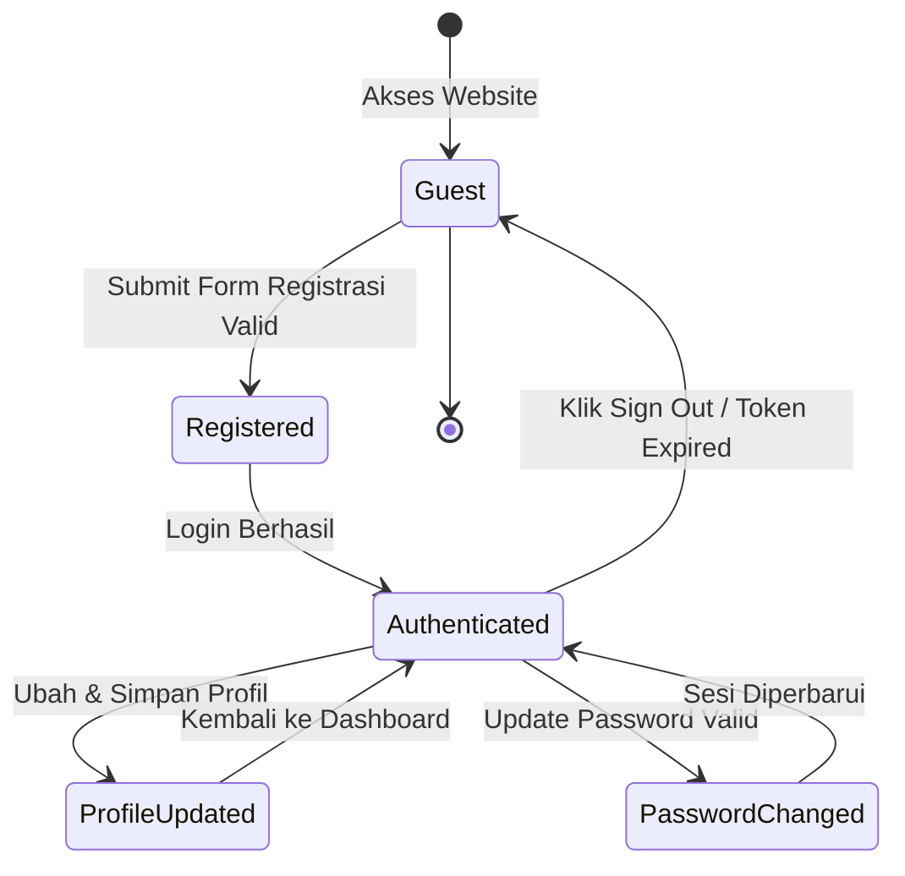

# Dokumen Perancangan Pengujian (Test Design & Analytical Analysis)
**Aplikasi Target**: [Practice Software Testing - Toolshop](https://practicesoftwaretesting.com)  
**Lingkup Pengujian**: Register, Login, Edit Profile (termasuk Ganti Password), dan Navigasi Menu  
**Deliverable**: Bagian 1 — Analytical & Test Design (Bobot 35%)  
**Penyusun**: QA Engineering Candidate  

---

## 1. Risk Analysis (Analisis Risiko)

Analisis risiko dilakukan untuk mengidentifikasi potensi kegagalan sistem pada fitur utama, mengevaluasi dampaknya terhadap pengguna dan bisnis, serta menentukan prioritas strategi pengujian.

### Matriks Penilaian Risiko
- **Likelihood (L)**: Peluang terjadinya kegagalan (1: Rendah, 2: Sedang, 3: Tinggi)
- **Impact (I)**: Dampak kegagalan terhadap operasional/pengguna (1: Minor, 2: Signifikan, 3: Kritis/Fatal)
- **Risk Score**: $\text{Likelihood} \times \text{Impact}$ (Rentang 1 s.d. 9)

### Tabel Area Risiko Tinggi (Diurutkan Berdasarkan Skor)

| No | Area Risiko | Likelihood (1–3) | Impact (1–3) | Risk Score (L × I) | Tingkat Risiko | Alasan & Potensi Dampak | Strategi Mitigasi / Pengujian |
|:--:|:---|:---:|:---:|:---:|:---:|:---|:---|
| **R-01** | **Autentikasi & Penyimpanan Sesi (Session Hijacking / Broken Auth)** | 2 | 3 | **6** | **High** | Jika token autentikasi tidak diamankan dengan benar atau sesi tidak dibatalkan saat logout/ganti password, akun pengguna rentan diambil alih. | Uji ketahanan sesi, verifikasi pembatalan token pasca logout dan ganti password, validasi proteksi route private. |
| **R-02** | **Validasi Aturan Bisnis Batasan Usia (DOB Validation Bypass)** | 3 | 2 | **6** | **High** | Toolshop mensyaratkan pengguna berusia 18–75 tahun. Seringkali validasi hanya di UI sehingga rentan dibypass via API payload langsung. | Terapkan Boundary Value Analysis (BVA) pada field tanggal lahir baik melalui UI form maupun integrasi API backend. |
| **R-03** | **Persistensi Data Pembaruan Profil (Data Loss / Desynchronization)** | 2 | 3 | **6** | **High** | Pengguna yang memperbarui alamat pengiriman atau nomor telepon dapat mengalami kegagalan simpan, berakibat salah alamat pengiriman saat checkout. | Uji skenario update, refresh browser, verifikasi data tersimpan di backend, dan lakukan pemesanan dengan data baru. |
| **R-04** | **Penggantian Password Tanpa Validasi Password Lama yang Kuat** | 2 | 3 | **6** | **High** | Jika endpoint ganti password tidak memvalidasi kecocokan password lama atau mengizinkan password baru yang lemah, akun mudah dikompromikan. | Uji penolakan ketika password lama salah, serta uji aturan kompleksitas password baru (huruf besar, kecil, angka, simbol). |
| **R-05** | **Duplikasi Email & Pendaftaran Akun Bersamaan (Race Condition)** | 3 | 2 | **6** | **High** | Registrasi dengan email yang sama secara bersamaan berisiko menyebabkan data corrupt atau akun ganda jika tidak ada unique constraint di DB. | Uji negative pendaftaran dengan email terdaftar, uji respon status HTTP 422/409, dan feedback pesan error pada UI. |
| **R-06** | **Keamanan Input Form (Cross-Site Scripting / SQLi pada Profile)** | 2 | 3 | **6** | **High** | Field profil (nama, alamat, kota) yang tidak disanitasi dapat menjadi celah Stored XSS saat ditampilkan di dashboard atau invoice. | Uji karakter spesial, tag HTML (`<script>`, `<b>`), kutip tunggal/ganda, dan verifikasi enkoding karakter pada UI. |
| **R-07** | **Inkonsistensi Filter & Navigasi Kategori Produk (Broken Routing)** | 2 | 2 | **4** | **Medium** | Jika routing kategori (Hand Tools, Power Tools) bermasalah atau state kategori tidak sync dengan URL query, katalog produk gagal tampil. | Uji navigasi menu bertingkat, verifikasi sinkronisasi URL slug, validasi jumlah dan relevansi produk yang terfilter. |

---

## 2. Test Scenario (Gherkin / BDD)

Skenario BDD disusun menggunakan pendekatan **declarative** (berorientasi pada tujuan bisnis dan nilai pengguna), menghindari instruksi imperatif teknis seperti *click input* atau *type character*.

File spesifikasi resmi tersimpan di repository pada:  
`features/auth_profile_navigation.feature`

```gherkin
Feature: User Authentication, Profile Management, and Navigation
  As a customer of Toolshop
  I want to register, authenticate, manage my personal profile, and browse product categories
  So that I can securely manage my account and find tools easily

  Background:
    Given the customer is on the Toolshop application home page

  # ---------------------------------------------------------------------------
  # 1. USER REGISTRATION
  # ---------------------------------------------------------------------------
  @auth @register @smoke @positive
  Scenario: Successful customer registration with valid personal details
    Given the customer navigates to the registration page
    When the customer submits the registration form with valid and complete personal information
    Then the system should register the new account successfully
    And the customer should be redirected to the login page with a success confirmation

  @auth @register @negative
  Scenario: Registration rejected when applicant is under legal age (under 18 years old)
    Given the customer navigates to the registration page
    When the customer attempts to register with a date of birth indicating age younger than 18 years
    Then the system should reject the registration submission
    And an age validation error stating that the customer must be at least 18 years old should be displayed

  # ---------------------------------------------------------------------------
  # 2. USER LOGIN (SCENARIO OUTLINE)
  # ---------------------------------------------------------------------------
  @auth @login @data-driven
  Scenario Outline: Customer login attempts with various credential states
    Given the customer navigates to the login page
    When the customer attempts to sign in with email "<email>" and password "<password>"
    Then the authentication outcome should be "<status>"
    And the customer should receive the expected message "<expected_message>"

    Examples:
      | email                                | password         | status  | expected_message             |
      | customer@practicesoftwaretesting.com | welcome01        | SUCCESS | User dashboard displayed     |
      | customer@practicesoftwaretesting.com | WrongPassword99! | FAILED  | Invalid email or password    |
      | unregistered.user.2026@test.com      | ValidPass#2026   | FAILED  | Invalid email or password    |
      |                                      | ValidPass#2026   | FAILED  | E-mail is required           |
      | customer@practicesoftwaretesting.com |                  | FAILED  | Password is required         |

  # ---------------------------------------------------------------------------
  # 3. EDIT PROFILE
  # ---------------------------------------------------------------------------
  @profile @positive
  Scenario: Successful update of customer profile details
    Given the customer is authenticated with an active account
    And the customer accesses the account profile settings
    When the customer updates the phone number and residential address with new details
    Then the updated profile should be saved successfully
    And the new information should persist upon reloading the profile page

  # ---------------------------------------------------------------------------
  # 4. CHANGE PASSWORD
  # ---------------------------------------------------------------------------
  @profile @password @negative
  Scenario: Password change rejected when new password does not satisfy security complexity
    Given the customer is authenticated with an active account
    And the customer accesses the change password page
    When the customer attempts to set a weak new password lacking numbers or special characters
    Then the system should reject the password update request
    And a password complexity warning should prompt the customer to fulfill security requirements

  @profile @password @positive
  Scenario: Successful password change and re-authentication with new password
    Given the customer is authenticated with an active account
    And the customer accesses the change password page
    When the customer submits the correct current password and a valid new compliant password
    Then the account password should be updated successfully
    And the customer should be able to log in with the new password in a new session

  # ---------------------------------------------------------------------------
  # 5. MENU NAVIGATION
  # ---------------------------------------------------------------------------
  @navigation @catalog @positive
  Scenario: Targeted product catalog filtering through header category menu
    When the customer navigates to "Power Tools" via the top categories navigation menu
    Then the product catalog view should display only products classified under "Power Tools"
    And the page header and breadcrumb should display "Power Tools"
```

---

## 3. Test Case Detail

Berikut adalah 9 test case komprehensif (kombinasi skenario positif dan negatif) yang diturunkan dari skenario BDD dan analisis risiko di atas:

| ID | Judul Test Case | Precondition | Test Data | Steps (Langkah Pengujian) | Expected Result (Hasil yang Diharapkan) | Priority | Teknik Test Design | Link ke Scenario / Risk |
|:---|:---|:---|:---|:---|:---|:---:|:---:|:---:|
| **TC-REG-01** | Registrasi user baru dengan data lengkap & valid | Berada di halaman utama Toolshop, user belum login | Nama: `John Doe`, DOB: `1995-05-20` (31 thn), Email: `test_<timestamp>@auto.org`, Password: `Password@123`, Alamat lengkap terisi | 1. Buka menu Sign in -> Klik link Register.<br>2. Isi seluruh field dengan data valid.<br>3. Klik tombol 'Register'. | Berhasil register, redirect otomatis ke URL `/auth/login`, dan menampilkan pesan sukses pendaftaran. | High | Equivalence Partitioning (Valid) | Scenario 1 / R-02 |
| **TC-REG-02** | Registrasi ditolak saat usia pendaftar di bawah 18 tahun | Berada di halaman `/auth/register` | DOB dihitung hari ini - 17 tahun 364 hari (contoh: `2008-10-05`), field lain valid | 1. Lengkapi form registrasi dengan data valid.<br>2. Input DOB dengan usia 17 tahun.<br>3. Klik tombol 'Register'. | Tombol Register diblokir atau form memunculkan pesan validasi: usia minimal pendaftar adalah 18 tahun. Tidak ada user yang tersimpan di DB. | High | Boundary Value Analysis (Invalid Boundary) | Scenario 2 / R-02 |
| **TC-REG-03** | Registrasi ditolak saat email sudah terdaftar sebelumnya | Akun dengan email target sudah aktif di sistem | Email: `customer@practicesoftwaretesting.com`, field lain valid | 1. Buka form registrasi.<br>2. Isi field email dengan email yang sudah ada.<br>3. Klik tombol 'Register'. | Pendaftaran gagal, sistem menampilkan pesan error bahwa alamat email sudah digunakan (`E-mail already exists`). | High | Error Guessing | Scenario 1 / R-05 |
| **TC-LOG-01** | Login berhasil dengan kredensial valid | User sudah terdaftar dan berstatus aktif | Email: `customer@practicesoftwaretesting.com`, Password: `welcome01` | 1. Akses halaman `/auth/login`.<br>2. Input email dan password yang benar.<br>3. Klik tombol 'Login'. | Berhasil terotentikasi, redirect ke halaman akun/dashboard (`/account`), nama user muncul di header navigasi. | High | Decision Table (Rule 1) | Scenario 3 / R-01 |
| **TC-LOG-02** | Login ditolak ketika password salah | User sudah terdaftar | Email: `customer@practicesoftwaretesting.com`, Password: `SalahPassword#99` | 1. Akses `/auth/login`.<br>2. Input email valid dan password yang salah.<br>3. Klik tombol 'Login'. | Tetap di halaman login, muncul pesan peringatan: *'Invalid email or password'*, token sesi tidak dibuat. | High | Decision Table (Rule 3) | Scenario 3 / R-01 |
| **TC-LOG-03** | Validasi client-side ketika field email dan password dikosongkan | Berada di halaman `/auth/login` | Email: `""` (kosong), Password: `""` (kosong) | 1. Klik input email lalu tinggalkan kosong.<br>2. Klik input password lalu tinggalkan kosong.<br>3. Periksa feedback UI. | Muncul pesan error validasi: *'E-mail is required'* dan *'Password is required'*, tombol login tidak menjalankan proses POST. | Medium | Equivalence Partitioning (Empty Input) | Scenario 3 / R-01 |
| **TC-PRF-01** | Update data profil (alamat & nomor telepon) dan verifikasi persistensi | User login dan berada di halaman `/account/profile` | Phone: `081298765432`, Address: `Jl. Melati No. 45`, City: `Jakarta` | 1. Ubah nomor telepon dan alamat rumah.<br>2. Klik tombol 'Update Profile'.<br>3. Reload browser page (F5).<br>4. Periksa isi field form. | Muncul notifikasi profil berhasil diperbarui, dan setelah reload data yang baru tetap tersimpan pada field form. | High | State Transition Testing | Scenario 4 / R-03 |
| **TC-PWD-01** | Penggantian password gagal jika password baru tidak memenuhi kompleksitas | User login dan berada di halaman ganti password | Current Pass: `welcome01`, New Pass: `simplepass` (tanpa angka/simbol) | 1. Buka tab Change Password.<br>2. Masukkan password lama yang valid.<br>3. Masukkan password baru yang lemah.<br>4. Klik tombol simpan. | Sistem menolak perubahan password, muncul indikator atau pesan bahwa password harus memiliki huruf besar, kecil, angka, dan simbol. | High | Boundary & Decision Table | Scenario 5 / R-04 |
| **TC-NAV-01** | Navigasi menu kategori produk (Power Tools) | User berada di beranda situs | Kategori: `Power Tools` (Slug: `power-tools`) | 1. Klik menu dropdown 'Categories'.<br>2. Pilih 'Power Tools'.<br>3. Verifikasi halaman katalog produk yang ditampilkan. | URL berubah menjadi `/category/power-tools`, judul halaman menampilkan 'Power Tools', dan seluruh kartu produk yang tampil sesuai kategori. | Medium | State Transition Testing | Scenario 7 / R-07 |

---

## 4. Penerapan Teknik Test Design

Pengujian ini menerapkan 3 teknik rancang uji formal secara konkret:

### 4.1. Teknik 1: Equivalence Partitioning (EP) & Boundary Value Analysis (BVA)

Diterapkan pada aturan bisnis **Tanggal Lahir (Date of Birth)** pada registrasi akun:
> **Business Rule**: Pendaftar wajib berusia antara **18 tahun** sampai dengan **75 tahun** pada saat tanggal pendaftaran.  
> Asumsi tanggal pengujian: `2026-10-04`.

#### A. Equivalence Partitioning (Tabel Partisi)
| Kelas Partisi | Rentang Nilai (Usia) | Contoh Input Tanggal Lahir | Status Partisi | Expected Result |
|:---|:---:|:---:|:---:|:---|
| **P1** | Usia < 18 tahun (Minor) | `2012-05-10` (14 tahun) | **Invalid** | Ditolak dengan pesan: usia minimal 18 tahun |
| **P2** | 18 tahun $\le$ Usia $\le$ 75 tahun (Legal) | `1990-08-15` (36 tahun) | **Valid** | Diterima, registrasi dapat dilanjutkan |
| **P3** | Usia > 75 tahun (Senior di atas batas) | `1945-01-01` (81 tahun) | **Invalid** | Ditolak dengan pesan: usia maksimal 75 tahun |
| **P4** | Tanggal di masa depan (Future Date) | `2028-01-01` (-2 tahun) | **Invalid** | Ditolak dengan pesan: tanggal lahir tidak valid |
| **P5** | Format tanggal tidak sesuai / string acak | `abc-def-ghij` | **Invalid** | Validasi format input `YYYY-MM-DD` |

#### B. Boundary Value Analysis (Nilai Batas Batas Umur)
Nilai batas dihitung pada $N$ (titik batas), $N-1$ hari, dan $N+1$ hari:

```
          INVALID (P1)          |           VALID (P2)          |       INVALID (P3)
<-------------------------------|-------------------------------|---------------------------->
                   17 thn 364 hr| 18 thn 0 hr       75 thn 0 hr | 75 thn 1 hr
```

| Titik Uji | Nilai Uji (Relatif terhadap 04-10-2026) | Representasi Batas | Status | Expected Output |
|:---|:---:|:---:|:---:|:---|
| **BVA-01** | `2008-10-05` (17 thn 364 hari) | Just below minimum boundary ($18 - 1\text{ hari}$) | **Invalid** | Ditolak (Error: usia < 18 thn) |
| **BVA-02** | `2008-10-04` (Tepat 18 tahun hari ini) | Exact minimum valid boundary ($18$) | **Valid** | **Diterima** |
| **BVA-03** | `2008-10-03` (18 thn 1 hari) | Just above minimum boundary ($18 + 1\text{ hari}$) | **Valid** | **Diterima** |
| **BVA-04** | `1951-10-05` (74 thn 364 hari) | Just below maximum boundary ($75 - 1\text{ hari}$) | **Valid** | **Diterima** |
| **BVA-05** | `1951-10-04` (Tepat 75 tahun hari ini) | Exact maximum valid boundary ($75$) | **Valid** | **Diterima** |
| **BVA-06** | `1951-10-03` (75 thn 1 hari) | Just above maximum boundary ($75 + 1\text{ hari}$) | **Invalid** | Ditolak (Error: usia > 75 thn) |

---

### 4.2. Teknik 2: Decision Table Testing

Diterapkan pada **Logika Autentikasi Pengguna (Login Validation)** untuk memetakan seluruh kombinasi kondisi input dan aksi sistem:

#### Decision Table: User Authentication Matrix
| Kondisi / Faktor (Conditions) | R1 | R2 | R3 | R4 | R5 | R6 |
|:---|:---:|:---:|:---:|:---:|:---:|:---:|
| **C1**: Format Email Valid | Y | Y | Y | T | Y | T |
| **C2**: Email Terdaftar di Database | Y | Y | T | - | Y | - |
| **C3**: Password Cocok dengan Hash | Y | T | - | - | - | - |
| **C4**: Field Password Terisi | Y | Y | Y | Y | T | T |
| **Aksi Sistem (Actions)** | | | | | | |
| **A1**: Otentikasi Berhasil & Buat Token Sesi | **X** | | | | | |
| **A2**: Redirect ke `/account` Dashboard | **X** | | | | | |
| **A3**: Tampilkan Pesan *"Invalid email or password"* | | **X** | **X** | | | |
| **A4**: Tampilkan Validasi *"Format e-mail tidak valid"* | | | | **X** | | |
| **A5**: Tampilkan Validasi *"Password is required"* | | | | | **X** | **X** |
| **A6**: Catat Percobaan Gagal (Security Audit Log) | | **X** | **X** | | | |

*Keterangan: Y = Ya, T = Tidak, - = Don't Care (tidak mempengaruhi), X = Aksi dieksekusi.*

---

### 4.3. Teknik 3: State Transition Testing

Diterapkan pada **Siklus Hidup Akun Pelanggan (User Account Lifecycle)**:



#### Matriks Transisi Status (State Transition Matrix)
| Current State | Trigger / Event | Action yang Dijalankan | Next State |
|:---|:---|:---|:---|
| **S0: Guest (Unauthenticated)** | Input data valid & klik Register | Kirim data registrasi ke API `/users/register`, simpan data | **S1: Registered** |
| **S1: Registered** | Redirect ke `/auth/login` | Render form login dengan notifikasi pendaftaran | **S0: Guest** |
| **S0: Guest** | Masukkan kredensial valid & klik Login | Validasi DB, terbitkan JWT token, simpan ke `sessionStorage` | **S2: Authenticated** |
| **S2: Authenticated** | Ubah data profil & klik Update | Kirim PUT `/users/me`, update database | **S3: Profile Updated** |
| **S3: Profile Updated** | Refresh halaman browser | Ambil data terbaru dari GET `/users/me` | **S3: Profile Updated** |
| **S2: Authenticated** | Masukkan password lama + baru & klik Simpan | Kirim POST `/users/change-password`, enkripsi password baru | **S4: Password Changed** |
| **S2: Authenticated** | Klik tombol 'Sign Out' | Hapus JWT token dan info akun dari browser storage | **S0: Guest** |

---

## 5. Out of Scope & Asumsi

### 5.1. Out of Scope (Sengaja Tidak Dites & Alasannya)
1. **Verifikasi Email via Tautan SMTP / OTP**:
   - *Alasan*: Aplikasi demo Toolshop secara sengaja langsung mengaktifkan akun saat form registrasi di-submit tanpa mengirimkan email verifikasi nyata ke inbox.
2. **Transaksi Kartu Kredit / Payment Gateway Riil**:
   - *Alasan*: Lingkup Bagian 1 difokuskan pada manajemen pengguna (Register, Login, Edit Profile, Navigasi). Pemrosesan pembayaran berada di luar modul autentikasi akun.
3. **Integrasi Social Login (OAuth 2.0 via Google / Facebook)**:
   - *Alasan*: Fitur social login tidak diimplementasikan pada aplikasi Toolshop ini.
4. **Security Penetration Testing Mendalam (DAST / SQL Injection Payload Injection)**:
   - *Alasan*: Pengujian pada Bagian 1 berfokus pada fungsionalitas dan test design berbasis BDD, bukan automated security auditing.

### 5.2. Asumsi Pengujian
1. **Lingkungan Pengujian**: Aplikasi target diakses melalui domain resmi `https://practicesoftwaretesting.com` yang berjalan pada environment staging/demo publik yang stabil.
2. **Kemandirian Data Uji (Test Data Isolation)**: Setiap eksekusi registrasi menggunakan generator data unik (misalnya email berformat `user_<timestamp>@mailslurp.biz`) guna mencegah kegagalan akibat bentrok email unik yang sudah terdaftar sebelumnya.
3. **Waktu Server & Lokasi**: Perhitungan batasan usia 18–75 tahun mengacu pada tanggal sistem saat pengujian dijalankan.
4. **Browser**: Pengujian dirancang untuk kompatibilitas browser berbasis Chromium modern (Google Chrome, Microsoft Edge).
