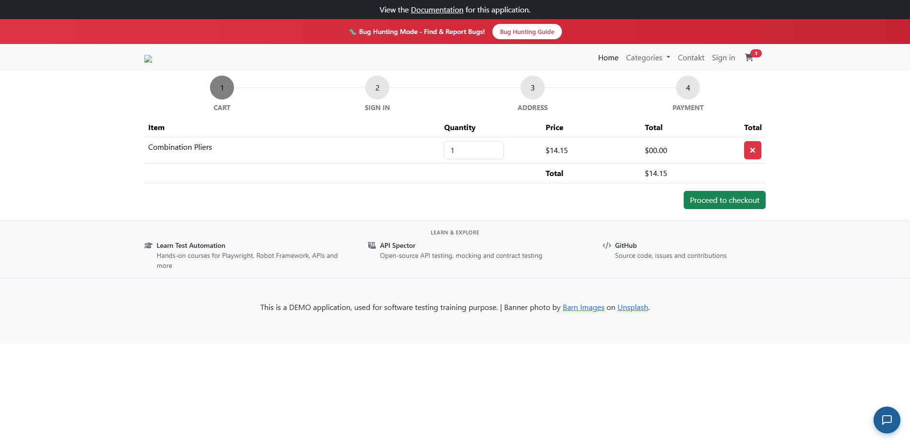
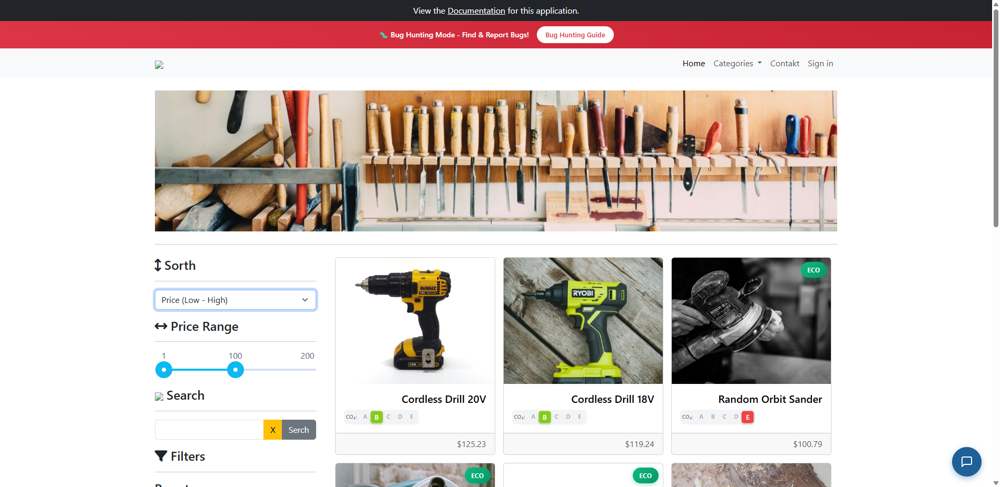
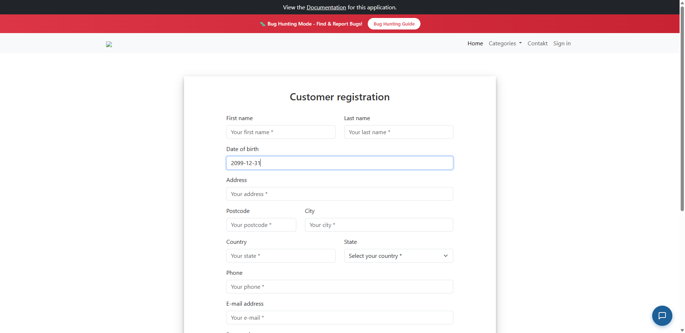
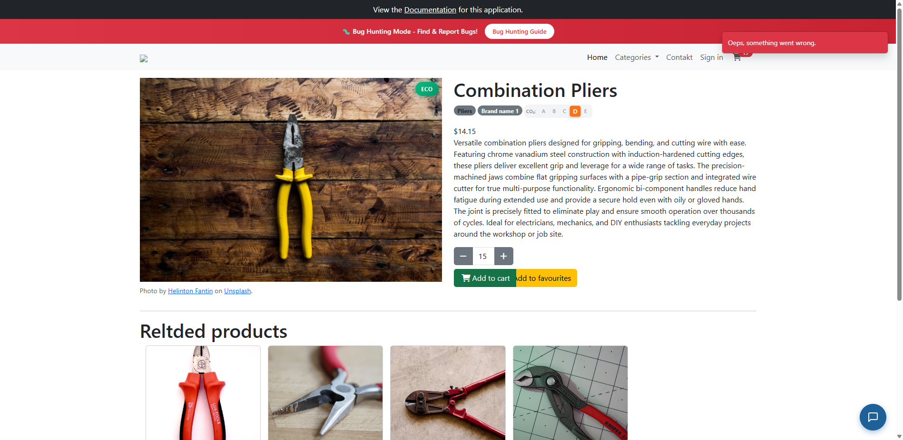
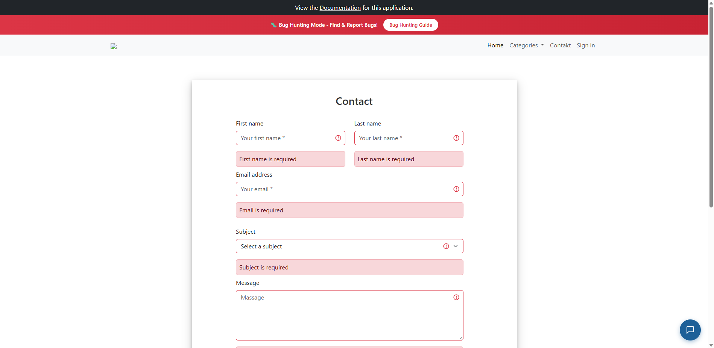

# Laporan Bug Hunting & Exploratory Testing (Bagian 3)

**Kandidat:** Ageng QA  
**Posisi:** QA Engineer / Automation QA  
**SUT (System Under Test):** [with-bugs.practicesoftwaretesting.com](https://with-bugs.practicesoftwaretesting.com)  
**Tipe Pengujian:** Timeboxed Exploratory Testing (60 Menit)  
**Waktu Pengujian:** 04 Oktober 2026, 12:35 WIB – 13:25 WIB (Durasi: 50 menit)  
**Environment Uji:** Google Chrome v134.0 (Desktop 1920x1080), Windows 11 Pro 64-bit  

---

## 1. Definisi Severity & Priority

Standar klasifikasi tingkat keparahan (*Severity*) dan urgensi perbaikan (*Priority*) yang diterapkan mengacu pada acuan teknis Logique:

| Level | Severity (Dampak ke Sistem / User) | Priority (Urgensi Perbaikan) |
| :--- | :--- | :--- |
| **Critical / P1** | Fitur utama tidak dapat digunakan sama sekali, kehilangan/korupsi data, celah finansial/keamanan, tanpa workaround. | Wajib diperbaiki dan diverifikasi sebelum rilis berikutnya (*Showstopper*). |
| **Major / P2** | Fungsi penting salah atau menghasilkan output keliru, namun pengguna masih memiliki *workaround* alternatif. | Harus masuk dan diselesaikan dalam *sprint* berjalan saat ini. |
| **Minor / P3** | Fungsi sekunder/opsional salah atau tidak konsisten, dampak operasional terbatas dan tidak memblokir user flow. | Masuk ke dalam *backlog* terencana untuk *release* berikutnya. |
| **Trivial / P4** | Masalah kosmetik, salah ketik (*typo*), layout misalignment ringan yang tidak mempengaruhi fungsionalitas. | Diperbaiki bila ada waktu luang / *code polish*. |

---

## 2. Ringkasan Daftar Temuan Bug

| Bug ID | Judul Bug | Area | Severity | Priority | Status |
| :--- | :--- | :--- | :---: | :---: | :---: |
| **BUG-001** | Total Harga Baris Keranjang Belanja Terhitung $00.00 (Kalkulasi Subtotal Rusak) | Checkout / Cart | **Critical** | **P1** | OPEN |
| **BUG-002** | Pengurutan Produk Terbalik (Opsi 'Price Low - High' Mengurutkan dari Tertinggi) | Catalog / Sorting | **Major** | **P2** | OPEN |
| **BUG-003** | Label dan Form Input Tertukar pada Kolom 'Country' dan 'State' di Registrasi | Register / UI Mapping | **Major** | **P2** | OPEN |
| **BUG-004** | Validasi Tanggal Lahir (DOB) Mengizinkan Tanggal di Masa Depan (Future Date) | Register / Validation | **Major** | **P2** | OPEN |
| **BUG-005** | Duplikasi Nama Header Kolom 'Total' pada Tabel Keranjang Belanja | Checkout / Cart Table | **Minor** | **P3** | OPEN |
| **BUG-006** | Asset Logo Toolshop pada Header Aplikasi Mengalami Broken Image (HTTP 404) | Global Header / Assets | **Minor** | **P3** | OPEN |
| **BUG-007** | Berbagai Kesalahan Ejaan (*Typo*) pada Komponen Kunci UI Aplikasi | Global UI / Copywriting | **Trivial** | **P4** | OPEN |

---

## 3. Rincian Laporan Bug (Detailed Bug Reports)

---

### BUG-001: Total Harga Baris Keranjang Belanja Terhitung $00.00 (Kalkulasi Subtotal Rusak)

- **ID:** BUG-001
- **Judul:** Nilai kalkulasi subtotal pada baris produk di halaman Checkout/Cart menampilkan `$00.00` meskipun harga satuan dan kuantitas valid.
- **Area:** Checkout & Cart (Financial Calculation & Business Logic)
- **Environment:** Chrome 134.0 / Windows 11 Pro 64-bit
- **Steps to Reproduce:**
  1. Buka halaman utama `https://with-bugs.practicesoftwaretesting.com`.
  2. Klik salah satu produk (misalnya: *Combination Pliers* seharga `$14.15`).
  3. Pastikan kuantitas produk minimal 1, lalu klik tombol **Add to cart**.
  4. Buka halaman keranjang belanja melalui ikon Cart di navbar atau URL `/#/checkout`.
  5. Perhatikan kolom **Total** pada baris produk pertama.
- **Expected Result:**
  Kolom `Total` pada baris produk harus menghitung `Price × Quantity` secara tepat (misal: `$14.15 × 1 = $14.15`).
- **Actual Result:**
  Kolom `Total` pada baris produk menampilkan nilai `$00.00`, padahal harga satuan tertera `$14.15` dan baris ringkasan Grand Total di bawahnya menampilkan `$14.15`.
- **Evidence:**  
  
- **Severity:** **Critical**
- **Priority:** **P1**
- **Alasan Severity & Priority:**  
  Menyebabkan kebingungan transaksi finansial bagi pembeli, berpotensi dimanfaatkan pengguna untuk mengeksploitasi celah checkout gratis jika data subtotal baris dikirimkan ke backend payment gateway, dan merusak integritas data invoice.

---

### BUG-002: Pengurutan Produk Terbalik (Opsi 'Price Low - High' Mengurutkan dari Tertinggi)

- **ID:** BUG-002
- **Judul:** Filter pengurutan harga terbalik: memilih opsi harga terendah ke tertinggi (`Price Low - High`) justru mengurutkan produk dari harga paling mahal.
- **Area:** Product Catalog / Filter & Sorting
- **Environment:** Chrome 134.0 / Windows 11 Pro 64-bit
- **Steps to Reproduce:**
  1. Akses halaman katalog produk `https://with-bugs.practicesoftwaretesting.com`.
  2. Buka dropdown pengurutan pada sidebar kiri yang berlabel *Sorth*.
  3. Pilih opsi **Price (Low - High)**.
  4. Perhatikan urutan harga produk yang ditampilkan pada grid katalog.
- **Expected Result:**
  Produk termurah (misalnya produk seharga `$10.00` – `$15.00`) ditampilkan pertama, diikuti produk dengan harga yang semakin tinggi.
- **Actual Result:**
  Aplikasi justru menampilkan produk termahal terlebih dahulu (*Cordless Drill 20V* seharga `$125.23`, *Cordless Drill 18V* seharga `$119.24`, *Random Orbit Sander* seharga `$100.79`). Berdasarkan inspeksi tab Network, frontend memetakan query string `sort=price,desc` alih-alih `sort=price,asc`.
- **Evidence:**  
  
- **Severity:** **Major**
- **Priority:** **P2**
- **Alasan Severity & Priority:**  
  Fitur pencarian dan pengurutan harga adalah fitur navigasi inti pada e-commerce. Hasil yang terbalik menyesatkan pengalaman berbelanja calon pembeli, namun pengguna masih dapat mencari produk secara manual melalui kotak pencarian (*workaround* tersedia).

---

### BUG-003: Label dan Form Input Tertukar pada Kolom 'Country' dan 'State' di Registrasi

- **ID:** BUG-003
- **Judul:** Label `Country` berada di atas field input State, sedangkan label `State` berada di atas dropdown Country.
- **Area:** Customer Registration / Form UI & Data Mapping
- **Environment:** Chrome 134.0 / Windows 11 Pro 64-bit
- **Steps to Reproduce:**
  1. Buka halaman pendaftaran pelanggan `https://with-bugs.practicesoftwaretesting.com/#/auth/register`.
  2. Gulir ke bagian alamat pelanggan (*Address information*).
  3. Perhatikan pasangan label dan input field untuk negara dan provinsi/negara bagian.
- **Expected Result:**
  Label `Country` harus memayungi dropdown pilihan negara, dan label `State` memayungi field input provinsi/negara bagian.
- **Actual Result:**
  - Label teks **Country** memayungi elemen input teks bertuliskan placeholder `Your state *`.
  - Label teks **State** memayungi elemen `<select>` dropdown bertuliskan `Select your country *`.
- **Evidence:**  
  
- **Severity:** **Major**
- **Priority:** **P2**
- **Alasan Severity & Priority:**  
  Menyebabkan data geografi pengiriman pesanan tersimpan secara terbalik di database (*State* tersimpan sebagai *Country* dan sebaliknya). Hal ini dapat menggagalkan proses kalkulasi ongkos kirim dan pengiriman fisik barang.

---

### BUG-004: Validasi Tanggal Lahir (DOB) Mengizinkan Tanggal di Masa Depan (Future Date)

- **ID:** BUG-004
- **Judul:** Field input Date of Birth (DOB) menerima tanggal lahir di masa depan tanpa ada penolakan validasi client maupun server.
- **Area:** Customer Registration / Input Data Validation
- **Environment:** Chrome 134.0 / Windows 11 Pro 64-bit
- **Steps to Reproduce:**
  1. Buka formulir registrasi `https://with-bugs.practicesoftwaretesting.com/#/auth/register`.
  2. Pada input field `Date of birth`, ketikkan tanggal di masa depan, misalnya `2099-12-31`.
  3. Lengkapi seluruh field lainnya dengan data valid, lalu klik tombol **Register**.
- **Expected Result:**
  Sistem menolak input dan memunculkan pesan validasi: *"Date of birth cannot be in the future"* atau memvalidasi batas usia minimal pembeli (misal: 18 tahun).
- **Actual Result:**
  Input `dob` bertipe `text` biasa (bukan elemen date picker dengan batasan `max`), dan formulir meloloskan tanggal `2099-12-31` tanpa ada indikasi error validasi sama sekali.
- **Evidence:**  
  
- **Severity:** **Major**
- **Priority:** **P2**
- **Alasan Severity & Priority:**  
  Pelanggaran integritas data dan kepatuhan hukum (*regulatory compliance* terkait batas usia transaksi e-commerce). Data profil pengguna menjadi korup dengan tanggal lahir yang tidak masuk akal secara biologis.

---

### BUG-005: Duplikasi Nama Header Kolom 'Total' pada Tabel Keranjang Belanja

- **ID:** BUG-005
- **Judul:** Terdapat dua header kolom berturut-turut dengan nama 'Total' pada tabel ringkasan belanja di halaman Checkout.
- **Area:** Checkout & Cart / Table Structure
- **Environment:** Chrome 134.0 / Windows 11 Pro 64-bit
- **Steps to Reproduce:**
  1. Tambahkan produk apapun ke dalam cart.
  2. Navigasikan ke halaman Checkout `https://with-bugs.practicesoftwaretesting.com/#/checkout`.
  3. Amati susunan header tabel: `Item` | `Quantity` | `Price` | `Total` | `Total`.
- **Expected Result:**
  Kolom kelima yang berisi tombol hapus (*trash/remove*) seharusnya berjudul `Action` atau dibiarkan tanpa teks header.
- **Actual Result:**
  Kolom keempat dan kelima keduanya menggunakan tag `<th>` bertuliskan teks identik `Total`.
- **Evidence:**  
  
- **Severity:** **Minor**
- **Priority:** **P3**
- **Alasan Severity & Priority:**  
  Tidak merusak fungsionalitas penghapusan barang, namun merusak estetika dan aksesibilitas tabel (*screen reader* untuk pengguna disabilitas akan membacakan header ganda yang membingungkan).

---

### BUG-006: Asset Logo Toolshop pada Header Aplikasi Mengalami Broken Image (HTTP 404)

- **ID:** BUG-006
- **Judul:** Gambar logo utama Toolshop di pojok kiri atas navbar tidak muncul dan menghasilkan error 404 pada network request.
- **Area:** Global Navigation Header / Asset Resource
- **Environment:** Chrome 134.0 / Windows 11 Pro 64-bit
- **Steps to Reproduce:**
  1. Buka halaman manapun di situs `https://with-bugs.practicesoftwaretesting.com`.
  2. Perhatikan logo di sudut kiri atas navbar.
  3. Buka browser Developer Tools (`F12`) -> Tab Console & Network.
- **Expected Result:**
  Logo Toolshop (`logo.png` atau file SVG) ditampilkan secara utuh dan mengembalikan status HTTP 200 OK.
- **Actual Result:**
  Elemen `` menampilkan icon broken image. Pada log browser console tercatat error: `GET https://with-bugs.practicesoftwaretesting.com/broken.png net::ERR_HTTP_RESPONSE_CODE_FAILURE 404 (Not Found)`.
- **Evidence:**  
  
- **Severity:** **Minor**
- **Priority:** **P3**
- **Alasan Severity & Priority:**  
  Mencerminkan citra profesional yang buruk (*brand reputation*) pada halaman muka aplikasi, namun pengguna masih dapat mengklik logo untuk kembali ke beranda.

---

### BUG-007: Berbagai Kesalahan Ejaan (*Typo*) pada Komponen Kunci UI Aplikasi

- **ID:** BUG-007
- **Judul:** Ditemukan sejumlah kesalahan penulisan kata (*misspelling/typo*) pada komponen navigasi, pencarian, dan formulir aplikasi.
- **Area:** Global UI & Copywriting
- **Environment:** Chrome 134.0 / Windows 11 Pro 64-bit
- **Steps to Reproduce & Temuan Spesifik:**
  1. **Menu Navigasi:** Menu kontak pada header tertulis `Contakt` (dengan huruf 'k', seharusnya `Contact`).
  2. **Filter Sidebar:** Judul pengurutan tertulis `Sorth` (seharusnya `Sort`).
  3. **Tombol Pencarian:** Tombol aksi search tertulis `Serch` (seharusnya `Search`).
  4. **Halaman Detail Produk:** Judul produk terkait tertulis `Reltded products` (seharusnya `Related products`).
  5. **Halaman Kontak Kami:** Placeholder pada textarea pesan tertulis `Massage` (yang bermakna 'pijat', seharusnya `Message`).
- **Expected Result:**
  Seluruh teks antarmuka bahasa Inggris menggunakan ejaan standar yang baku dan konsisten.
- **Actual Result:**
  Teks antarmuka mengandung banyak salah ketik yang menurunkan kredibilitas platform.
- **Evidence:**  
  - Typo *Sorth* & *Serch*: 
  - Typo *Reltded products*: 
  - Typo *Contakt* & *Massage*: 
- **Severity:** **Trivial**
- **Priority:** **P4**
- **Alasan Severity & Priority:**  
  Hanya berdampak pada aspek visual dan kredibilitas tata bahasa tanpa mengganggu alur fungsi teknis aplikasi sama sekali.

---

## 4. Ringkasan Evaluasi Area Paling Rawan & Rencana Pengujian Lanjutan

Berdasarkan exploratory testing selama 50 menit, **area yang paling rawan dan kritis adalah modul Checkout & Kalkulasi Finansial serta Validasi Integritas Formulir Pengguna (Auth & Address)**. Kegagalan subtotal keranjang menghitung `$00.00` dan tertukarnya pemetaan field geografi (*Country* vs *State*) dapat langsung melumpuhkan operasional bisnis dan transaksi riil.

Bila diberikan waktu tambahan untuk pengujian lanjutan, saya akan berfokus pada:
1. **Pengujian Penetrasi & Validasi Input (Security Testing):** Menguji injeksi XSS dan SQLi pada field yang tidak tersanitasi (seperti field nama kontak dan address), serta pengujian manipulasi parameter harga via modifikasi payload HTTP request saat checkout.
2. **Kupon Diskon & Multi-Currency Boundary:** Menguji pengaplikasian kupon diskon dengan nilai persentase di luar rentang wajar (misal: diskon > 100%, kupon kedaluwarsa, atau kupon dengan kuantitas produk nol).
3. **Session Management & Concurrency:** Menguji perilaku keranjang belanja saat user login dari dua tab/perangkat berbeda secara bersamaan ketika stok produk menipis (*race condition stock deduction*).
